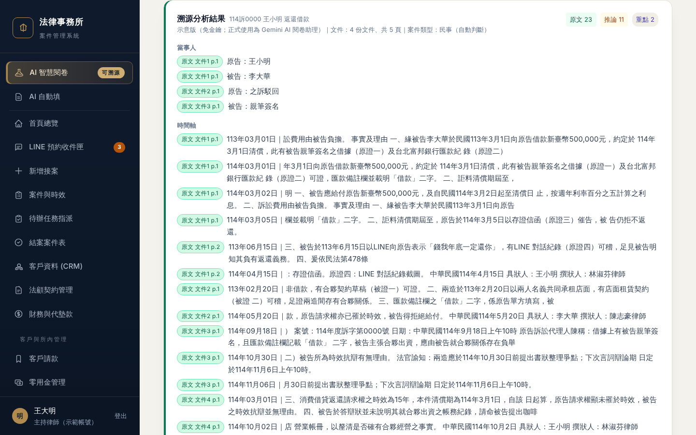
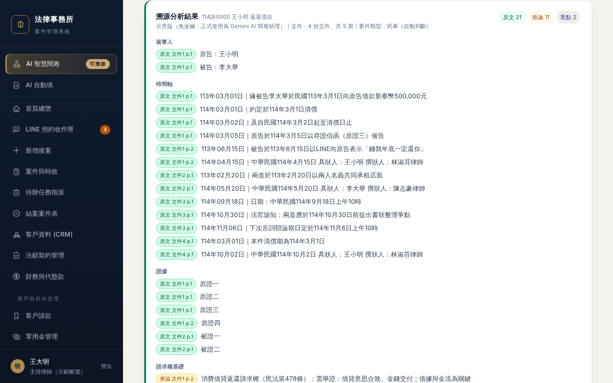

# 整合紀錄（2026-11-06 決賽版候選）

> 分支：`release/1106`（從 main `f5d5d57` 開出）｜**main 完全沒動、沒開 PR、沒合併到 main**
> 備份：`backup/main-1104`（＝目前 main 的原樣，出事一鍵退回用）
> 要不要合併到 main，由你在筆電用真金鑰照第五節試過後自己決定。

---

## ① 合併了什麼

| 分支 | 內容 | 合併結果 |
|---|---|---|
| `feature/deidentify` | 去識別化：送 Gemini 前把姓名、電話、地址等換成代號，律師先看「將送出的版本」再按確認，結果回來換回真名 | 無衝突 |
| `feature/ai-autofill` | 左側新增「AI 自動填」：判決／書狀 → 自動填案件＋期限；開庭通知（PDF 或照片）→ 排進開庭行事曆 | 無衝突 |
| `feature/progress-report` | 案件詳情新增「📨 產生進度回報」：用固定句型產生給當事人的進度訊息草稿（不寄出、不用 AI） | 無衝突 |

**AI 自動填已自動用上去識別化**：合併後，AI 自動填頁面上方的橫幅變成綠色「🛡️ 已載入去識別化模組」，讀判決時狀態寫「已遮蔽 5 項個資」，原本的紅字「尚未遮蔽個資」不再出現（截圖 `功能2_AI自動填_判決逐欄確認.png`）。

唯一例外是**照片**：照片沒辦法先遮個資（這是原本就知道的限制）。原本照片也會顯示同樣的紅字「尚未遮蔽個資」，跟上方綠色橫幅放在一起容易誤會，所以改成「照片無法先遮個資」（見下表第 17 項）。選 Gemini 送照片時，仍要另外勾「圖片會原樣送給 Google」才會送。

---

## ② 修了哪些字（改之前 → 改之後，原文照抄）

第 1～12 項是指定要修的（體檢第 3、4、5 項＋雲端字眼＋沒根據的數字）。
第 13～15 項是體檢「建議修」裡的 S4、S7、S8：只改字、不動版面，而且跟這次要處理的「別讓人以為已經上線／資料外流」同一類，所以一起改；**如果你不想要，這三處可以單獨改回**。
字級、手機排版（S1～S3）**沒有動**。

| # | 哪一類 | 位置 | 改之前 | 改之後 |
|---|---|---|---|---|
| 1 | 第 3 項 | AI 頁上方黃框 | 讀文件、整理爭點；結果一律經過「回文件逐字比對」的防幻覺檢查，並標示原文／推論／重點。沒有金鑰時 | 讀文件、整理爭點，並標示原文／推論／重點。標為「原文」的句子可以一鍵跳回文件原句對照；「推論」是綜合判斷、對不到單一句子，由律師自行確認。沒有金鑰時 |
| 2 | 第 3 項 | AI 頁底部小字 | 防幻覺機制：AI 標為「原文」的每一句，系統會回到文件逐字比對；比對不到就自動改列為「重點」。法條、判決字號、金額一律列為「重點」，必須點開人工核對。 | 防幻覺機制：AI 標為「原文」的句子，系統會到文件裡找相同的句子，找到的可以一鍵跳回文件原句對照；找不到就改列為「重點」，提醒律師自己看原文。「推論」是綜合判斷、對不到單一句子，由律師自行確認。 |
| 3 | 第 3 項 | AI 頁角色設定說明「規矩」 | 規矩：每一項都要附頁碼與文件原句；法條、判決字號、金額一律列為「重點」；文件沒寫的不准編 | 規矩：標為原文的項目要附頁碼與文件原句；推論盡量附上依據的原句，沒有就留空；法條、判決字號、金額列為「重點」；文件沒寫的不准編 |
| 4 | 第 4 項 | 匯出報告頁尾 | 本報告由 AI 閱卷助理整理、經律師核對。「原文」為文件逐字摘錄，「推論」為 AI 判斷，「重點」為法條、金額等關鍵項目，每項都附文件出處，「已確認」為律師對照過原文的項目。僅供事務所內部參考，不構成法律意見。 | 本報告由 AI 整理，使用前須經律師核對；標為原文的項目附文件出處。「原文」為文件逐字摘錄，「推論」為 AI 綜合判斷、不一定有出處，「重點」為法條、金額等關鍵項目，「已確認」為律師對照過原文的項目。僅供事務所內部參考，不構成法律意見。 |
| 5 | 第 5 項 | 首頁利益衝突查詢說明 | ① 示範管制表（虛構資料，正式版約八千筆）② 本系統客戶／現有案件當事人與對造／已結案紀錄。管制表最新異動請以下方線上版為準 | ① 示範管制表（虛構資料）② 本系統客戶／現有案件當事人與對造／已結案紀錄。 |
| 6 | 第 5 項 | 首頁利益衝突查詢小字 | 正式版連結事務所的線上管制表並可一鍵同步；示範版只使用內建的虛構資料。 | 比賽示範版只使用內建的虛構資料，不連線上管制表。 |
| 7 | 第 5 項 | 首頁同步按鈕（示範版本來就隱藏） | 🔄 從線上管制表同步最新資料 | （示範版不提供同步） |
| 8 | 第 5 項 | 查詢結果：查無資料時 | 。管制表為 2026-07 匯入快照，之後新增的案件請再查線上版。 | 。示範管制表為虛構資料。 |
| 9 | 第 5 項 | 查詢結果：有命中時 | 管制表為 2026-07 匯入之快照（N 筆），之後的新增異動請以線上管制表為準；利益衝突認定仍需律師人工判斷。 | 示範管制表為虛構資料（N 筆）；利益衝突認定仍需律師人工判斷。 |
| 10 | 雲端字眼 | 手機版右上角重新整理鈕的提示 | title="重新整理（拉取雲端最新資料）" | title="重新整理畫面（示範版：資料只在這台電腦）" |
| 11 | 雲端字眼 | 垃圾桶頁說明 | 或「永久刪除」。跨裝置同步：任何人刪除或復原，其他人畫面會一起更新。 | 或「永久刪除」。比賽示範版沒有雲端：資料只在這台電腦的瀏覽器。 |
| 12 | 沒根據的數字 | LINE 預約收件匣流程 ③ | 律師依案情卡片準備，15 分鐘用在評估 | 律師諮詢前先看案情卡片 |
| 13 | 建議修 S4 | LINE 預約收件匣底部小字 | 正式版：預約資料由 LINE 接待系統寫入 | 設計上：預約資料可由 LINE 接待系統寫入 |
| 14 | 建議修 S7 | 登入畫面小字 | 選一個身分直接進入即可。資料只存在你自己的瀏覽器。 | 選一個身分直接進入即可。示範資料只存在你自己的瀏覽器；選用 Gemini 分析時，文件文字會傳送給 Google。 |
| 15 | 建議修 S8 | AI 頁沒貼文字就按分析的提示 | 上傳 PDF，或點「填入示範書狀」測試 | 上傳 PDF，或點「貼入示範文字（測試用）」測試 |
| 16 | 程式註解 | 程式註解（畫面看不到） | // 比賽版：重點不需逐項確認，報告裡每項都附文件出處 | // 比賽版：重點不需逐項確認；標為原文的項目附文件出處 |
| 17 | 合併後順手 | AI 自動填：讀照片時的狀態字（modules/autofill.js） | ｜尚未遮蔽個資 | ｜照片無法先遮個資（只有照片會出現；文字檔已自動遮蔽） |
「改之後」的實際畫面：`docs/screenshots/1106/第3項_AI頁上方說明_修之後.png`、`第5項_首頁利益衝突查詢_修之後.png`。

改完後再搜尋一次全站：「一律經過」「每一句」「每項都附」「八千」「線上版為準」「匯入快照」「跨裝置同步：」「15 分鐘」都已經找不到。（「經律師核對」只剩在新頁尾的「使用前須經律師核對」裡。）

---

## ③ 第 2 項：一鍵示範結果第一個畫面出錯的原因

**看到的問題**：當事人多了「原告：之訴駁回」「被告：親筆簽名」；時間軸的內容常接到上一句（例：「113年03月01日｜訟費用由被告負擔。 事實及理由…」）。

**原因**（示意版是固定規則，不是 AI）：
1. **當事人**：規則是「找到『原告』『被告』，抓後面 2～14 個字當名字」，但沒有要求中間要有冒號。所以答辯狀裡的「原告**之訴駁回**」、筆錄裡的「被告**親筆簽名**之借據」都被當成人名。
2. **時間軸**：規則是「從日期往前固定抓 25 個字、往後抓 65 個字」，不管句子在哪裡斷。日期如果在句子開頭，往前那 25 個字就是上一句的尾巴，看起來像日期和內容對不上。

**怎麼修**（只改 `index.html` 裡示意版的兩條規則）：
1. 當事人：「原告」「被告」和名字中間一定要有「：」、「即」或空白（例如「原告：王小明」）；另外排除「之訴、駁回、簽名、負擔、主張…」這類明顯不是名字的字。
2. 時間軸：只取日期所在的那一句（往前、往後找到「，。；」為止；PDF 自動換行會接起來，但遇到「一、」「日期：」「中華民國」這類新段落開頭就停）。

**結果**：當事人只剩「原告：王小明」「被告：李大華」；時間軸 13 筆，每筆的日期都在自己那句話裡，而且都還是「原文」（每一句都在文件裡找得到原句）。原文標籤從 23 個變 21 個（少的就是那 2 個錯的當事人）。一鍵示範仍自動打開「03_言詞辯論筆錄｜第 1 頁」。

| 修之前 | 修之後 |
|---|---|
|  |  |

整段結果：`第2項_修之前_結果全段.png` → `第2項_修之後_結果全段.png`。

「貼入示範文字（測試用）」那條路也一起變好：當事人同樣只有王小明、李大華，時間軸 7 筆都是完整的一句。

另外新增一個自動檢查 `tests/demo-content.e2e.js`：拿**舊版**跑會抓出 1 個當事人錯誤＋5 筆時間軸錯誤（失敗）；**新版**跑全部通過。

---

## ④ 測試結果

| 測試 | 結果 |
|---|---|
| 去識別化 `node tests/deidentify.test.js` | **33 / 33 過** |
| AI 自動填 `node tests/autofill.test.js` | **26 / 26 過** |
| 進度回報 `node tests/progress-report.test.js` | **16 / 16 過** |
| 進度回報瀏覽器測試 `tests/progress-report.e2e.js` | 過（3 件案件草稿、提醒字眼、重新整理後資料還在、0 個錯誤） |
| 一鍵示範回歸 `tests/demo-regression.e2e.js` | 過（自動開「03_言詞辯論筆錄｜第 1 頁」，34 個標籤，0 個錯誤） |
| 一鍵示範內容（新增）`tests/demo-content.e2e.js` | 過（當事人 2 筆正確、時間軸 13 筆都對得上） |
| 桌機 1440×900 每頁每個按鈕 | 20 個頁面（含新的「AI 自動填」）、點了 **123 顆按鈕**：**0 個頁面錯誤、0 個 console 錯誤、0 個載入失敗**。只有人事頁一顆藏在收合區塊裡的「儲存員工」點不到，跟體檢時一樣，屬正常 |
| 三個新功能完整流程 | 都跑完，見下方截圖；全程 **0 次連到 Gemini**、0 個錯誤 |

三個新功能的截圖（`docs/screenshots/1106/`）：
- 去識別化：`功能1_去識別化_送出前預覽.png`（左邊 5 個人名→代號，右邊是 AI 會看到的全文）、`功能1_去識別化_結果已還原真名.png`（標「🛡️ 已去識別化 5 項後送出」，沒有殘留代號）
- AI 自動填：`功能2_AI自動填_判決逐欄確認.png`（綠色橫幅、已遮蔽 5 項）、`功能2_AI自動填_判決寫入完成.png`（建立 115訴8888，期限末日 2026-11-06）、`功能2_AI自動填_開庭通知照片.png`（比對到 113訴101，寫入 11/20 09:30）
- 進度回報：`功能3_進度回報草稿.png`

**備案影片**：`qa/demo-backup-1106.mp4`（1440×900，58 秒，3.4 MB）

| 時間 | 畫面 |
|---|---|
| 0 秒 | 開一鍵示範網址 `?demo=ding&autorun=pdf-view` |
| 7 秒 | 自動打開言詞辯論筆錄原句 |
| 13 秒 | 當事人與時間軸（已修正），往下捲 |
| 25 秒 | 點「重點」→ 對照起訴狀第 2 頁原文 |
| 30 秒 | 回頁首看 AI 頁說明文字（已改） |
| 34 秒 | 分析引擎切到「去識別化測試（假回應、不連網）」 |
| 40 秒 | **去識別化預覽畫面**（將送出的版本） |
| 46 秒 | 結果回來，已換回真名 |
| 48 秒 | AI 自動填（綠色橫幅）→ 判決逐欄附出處 |
| 57 秒 | 首頁利益衝突查詢（文字已改） |

**測試環境限制（跟體檢時一樣）**：這台雲端機器連不到外部 CDN，所以測試時把 pdf.js 3.11.174、xlsx 0.18.5 換成 npm 上的**同版本**，Tailwind 用 3.4.17 先編好的樣式頂替。只在測試瀏覽器裡替換，**沒有放進專案、網頁的引用也沒改**。線上網址也打不開，所以沒有測線上版。真的 Gemini 一次都沒呼叫（沒用任何金鑰）。

---

## ⑤ 你在筆電用真金鑰實測的步驟（約 10 分鐘）

> `release/1106` 還不在 GitHub Pages 上（Pages 從 main 發布），所以要在筆電本機開。

**準備（2 分鐘）**
1. 下載這個壓縮檔並解壓縮：https://github.com/din1lan/aida2026-lawfirm-demo/archive/refs/heads/release/1106.zip
2. 打開「終端機」（Windows：命令提示字元），切到解壓縮出來的資料夾。
3. 輸入 `python3 -m http.server 8000` 按 Enter（Windows 輸入 `py -m http.server 8000`）。
4. 用 Chrome 開 `http://localhost:8000/?demo=ding&autorun=pdf-view`，確認自動打開筆錄原句、當事人只有「王小明」「李大華」。

**AI 閱卷＋去識別化（3 分鐘）**
5. 在「AI 智慧閱卷」把「分析引擎」改成「AI 閱卷助理（Google Gemini）」。
6. 貼上金鑰 → 按「載入模型」→ 選一個 flash 模型 → 勾「同意傳送給 Google」。
7. 按「載入示範案件」→ 按「開始分析」。
8. 跳出「將送出的版本」：看右邊全文**沒有**王小明、李大華、林淑芬、陳志豪、黃美玲 → 按「確認送出」。
9. 結果上方要寫「🛡️ 已去識別化 N 項後送出」，內容裡是真名；**如果出現「⚠ 有 N 個代號無法還原」請截圖給我**。
10. 點任一個綠色「原文」標籤，確認會跳到文件原句（黃底）。

**AI 自動填書狀（2 分鐘）**
11. 左側點「AI 自動填」→「由誰讀」改成 Gemini → 確認上方是綠色「已載入去識別化模組」。
12. 按「範例：民事判決 PDF」→「讓 AI 讀」→ 狀態要寫「已遮蔽 N 項個資」。
13. 案件選「＋ 建立新案件」→ 勾一位律師 → 摘要裡期限要是 **2026-11-06** → 按「確認寫入」。

**開庭通知照片（2 分鐘）**
14. 切到「開庭通知排行事曆」→ 按「範例：開庭通知書照片」→ 勾「圖片會原樣送給 Google」→「讓 AI 讀」（照片不會遮個資，所以會顯示「照片無法先遮個資」，這是正常的）。
15. 確認比對到 **113訴101**、**11/20 09:30**、**第5法庭** → 按「確認寫入」。
16. 到「案件與時效」看開庭清單有 11/20 那一筆。

**收尾（1 分鐘）**
17. 關掉分頁（金鑰只存在這個分頁），回終端機按 Ctrl+C 停掉。
18. 都沒問題 → 再決定要不要合併到 main；有問題 → 截圖給我，main 不受影響。

---

## ⑥ 出事怎麼退回

- **main 完全沒動**。線上網站（從 main 發布）現在跟整合前一模一樣，這個分支不合併就不會影響決賽。
- 如果之後合併到 main 又想退回：把 main 改回 `backup/main-1104`（就是整合前的 main，commit `f5d5d57`）。
- 只想關掉某個新功能（合併後）：
  - AI 自動填：刪掉 `index.html` 結尾的 ``
  - 進度回報：刪掉 ``
  - 去識別化**不建議單獨關**：關掉後 AI 閱卷選 Gemini 會直接停止送出（設計上寧可不送，也不送未遮的原文）；示意版不受影響。
- 第 2 項的規則修正只動到 `index.html` 裡 `analyzeBriefLocally` 的當事人規則和新增的 `aibClauseAround`，只影響示意版。

## 還要你決定的事
1. 筆電用真金鑰照第五節跑一次，沒問題再決定要不要合併到 main（合併方式你決定；我沒有開 PR）。
2. 第 13～15 項（S4、S7、S8）是順手改的字，要不要留。
3. 體檢第 1 項（網路不穩）照原本計畫處理：上台前先跑一次不要關分頁、備案影片放在 `qa/demo-backup-1106.mp4`。
